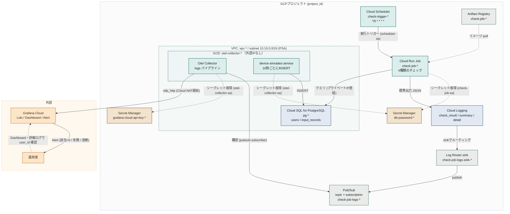

# GCPインフラ構成図

`terraform/` が構築する Google Cloud / Grafana Cloud のリソースと、その間を流れるデータ・制御・
認証情報のフロー。旧リポジトリ（data-update-monitor）の構成から Cloud Monitoring の経路
（カスタムメトリクス書込・`googlecloudmonitoring` receiver・Mimir）を削除し、デバイスシミュレーターを
GCE 上に追加している。

## 凡例

| 種別 | 色 | 対象 |
|---|---|---|
| コンピュート | 緑 | Cloud Scheduler / Cloud Run Job / Otel Collector / デバイスシミュレーター |
| データストア | 青 | Cloud SQL、Cloud Logging |
| シークレット | 茶 | Secret Manager（DBパスワード／Grafana OTLP APIキー） |
| サポートリソース | 灰 | Artifact Registry、Log Router sink、Pub/Sub |
| 外部 | 橙 | Grafana Cloud、運用者 |

- **実線矢印**：データ・制御フロー
- **点線矢印**：IAM経由のアクセス（シークレット取得・イメージpull）／運用者の確認
- **破線の枠（VPC）**：プライベートIP範囲の境界。外部IPを持たない

デバイスシミュレーターは検証・デモ専用（`enable_device_simulator` で有無を切り替え）。実際のシステムでは
「デバイス → 受信側 → DB登録」の経路になるが、監視対象は DB に登録されたデータのため検証では直接 INSERT する。
